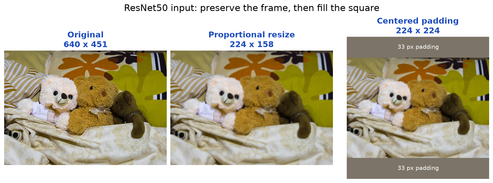
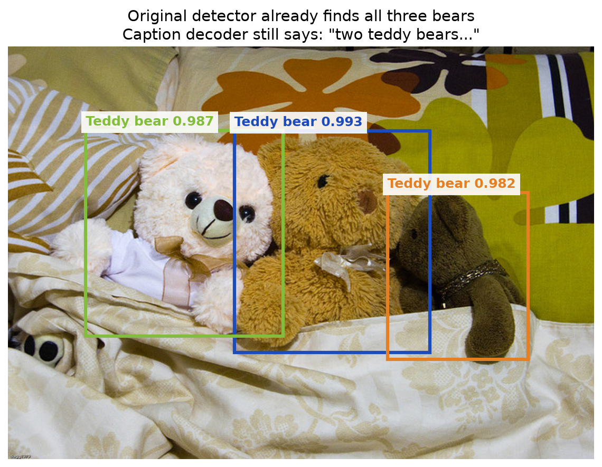
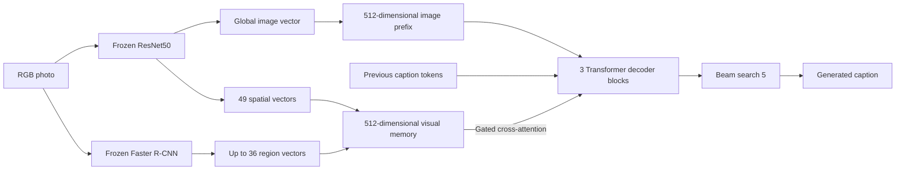

# PicToText: image captioning with CNNs and a Transformer decoder

Final project by **Askat Aubakirov and Bakdaulet Dagystanov, BDA2403**, Astana IT University.

The released model combines a ResNet50 global image prefix, 49 spatial feature vectors and up to 36 Faster R-CNN region vectors. A three-layer Transformer generates the caption. Both CNNs are frozen in this model; visual projections and gated cross-attention were trained with the decoder.

**The recommended model is still the original epoch 11 checkpoint with beam size 5 and the original image sizes.** Follow-up experiments on November 26 did not establish an improvement: higher resolutions scored worse on all 5,000 validation images, and unfinished CNN fine-tuning gave mixed results on a 100-image subset.

New to the project? Start with the [visual examples](docs/VISUAL_EXAMPLES.md) to see resizing, detected objects and real captions. Then use the photo notebook below to try the model yourself.

## Run the model on your photograph

Run these commands from the repository root after cloning:

```powershell
git clone https://github.com/AskatQwerty/AMLNN.git
cd AMLNN
```

1. Use Python 3.11 and install PyTorch 2.13.0 with torchvision 0.28.0 for your CPU or CUDA environment. The original environment used CUDA 12.6. See [environment and installation notes](docs/REPRODUCING.md).
2. Install the notebook dependencies:

   ```powershell
   python -m pip install -r requirements-captioning.txt
   ```

3. Download `final_model_inference.zip` from the [original model release](https://github.com/AskatQwerty/AMLNN/releases/tag/final-model-2026-11-16). Extract its contents under `local_artifacts/final_model/`, so these paths exist:

   ```text
   local_artifacts/final_model/
     selected_model/weights.pt
     selected_model/inference_config.json
     selected_model/source_run_config.json
     selected_model/vocabulary.json
     encoder_cache/checkpoints/resnet50-11ad3fa6.pth
     encoder_cache/checkpoints/fasterrcnn_resnet50_fpn_coco-258fb6c6.pth
   ```

4. Generate a caption:

   ```powershell
   python inference/caption_image.py --image "photo.jpg" --model-dir "local_artifacts/final_model/selected_model" --torch-cache "local_artifacts/final_model/encoder_cache" --device auto --output "caption.json"
   ```

For a notebook with the photo, caption and timer, run `python -m jupyterlab`, open [Final_Model_Photo.ipynb](Final_Model_Photo.ipynb), set the image path and run its cells. Your own photograph needs no COCO download, prepared captions or full-dataset feature extraction. See the [inference guide](inference/README.md) for CPU fallback and verification limits.

## Choose an entry point

| Goal | File or folder |
|---|---|
| Caption one image | [Photo notebook](Final_Model_Photo.ipynb) or [portable CLI](inference/README.md) |
| See resizing, detector boxes and captions | [Visual guide](docs/VISUAL_EXAMPLES.md) and [small CPU notebook](Data_Visual_Examples.ipynb) |
| Read the original submitted project | [Complete PDF: presentation, code, report](docs/AML_Final_Project_Complete.pdf), 322 pages |
| Inspect the executed project | [AML_Final_Submission.ipynb](AML_Final_Submission.ipynb) |
| View presentation materials | [Slides](docs/Presentation.pdf), [report](docs/Research_Report.pdf), [speaker notes](docs/Speaker_Notes.txt) |
| Understand the November 26 experiments | [Follow-up results and interpretation](docs/FOLLOWUP_EXPERIMENTS.md) |
| Compare image resolutions | [FinalFusion_Resolution.ipynb](FinalFusion_Resolution.ipynb) |
| Continue experimental CNN fine-tuning | [FinalFusion_FineTune.ipynb](FinalFusion_FineTune.ipynb) and [setup guide](docs/REPRODUCING.md) |
| Inspect original training | [Global models](FinalAML.ipynb), [spatial attention](SpatialAttention.ipynb), [fusion](FinalFusion.ipynb) |
| Browse saved evidence | [Results](results/), [preparation metadata](metadata/preparation/), [original stage-5 handoff](stage5_handoff/) |

The PDF and submission notebook are the historical submission. The November 26 experiments are separate additions. Saved notebook outputs can be read without running cells. New experimental notebooks have expensive launch switches off by default; a Git checkout alone does not include training images or weights.

## See what the image pipeline does

The ResNet branch keeps the complete image and its proportions: resize first, then add padding to make a 224×224 square. This 640×451 example becomes 224×158, with 33 pixels of padding above and below. The detector uses its own larger, aspect-preserving input.



Finding an object does not guarantee a correct caption. Here the original detector already found all three bears, but the decoder described two:



The [visual guide](docs/VISUAL_EXAMPLES.md) includes the saved model captions and human references. Its [example notebook](Data_Visual_Examples.ipynb) runs the resize demonstration on CPU and displays recorded detector outputs. It needs no model weights or full dataset download.

## How the final model combines visual information



Each decoder block combines causal self-attention, cross-attention to visual memory and a feed-forward network. Spatial positions, region box coordinates and padding masks preserve where the features came from. The global vector starts the text sequence; the other features remain available through cross-attention. Detector category names are not supplied as words.

## Original project results

All rows below use all **5,000 validation images** and all human captions. CIDEr-D is the native `pycocoevalcap==1.2` score, without an extra factor of 100; BLEU is in 0–1. The project uses its saved regex tokenizer, not official COCO leaderboard PTB tokenization.

| Experiment | Validation CIDEr-D | Note |
|---|---:|---|
| Best original RNN |0.6480|ResNet50, image LayerNorm|
| Best original LSTM |0.8047|ResNet50, two layers|
| Best original Transformer-prefix |0.8085|ResNet50, two layers|
| Global LSTM, three layers |0.8081|ResNet50|
| Global Transformer-prefix, three layers |0.8578|ResNet50|
| Spatial attention LSTM |0.7802|49 ResNet50 positions|
| Region attention LSTM, no visual LayerNorm |0.0514|Collapsed to one repeated caption|
| Region attention LSTM, visual LayerNorm |0.8185|Best epoch 25; stopped at 28|
| Fusion, greedy |0.9380|Epoch 11; same weights as the next row|
| **Fusion, beam 5, length penalty 0** |**0.9801**|**Selected final system, epoch 11**|

The original search contains **75 runs: five CNNs × three decoder families × five configurations**. Four additional ResNet50 depth experiments bring the global total to 79. ResNet50 led all three decoder families in the original search. Three layers helped the strongest global models; four did not. Higher dropout (0.3→0.5) did not help any of the 15 matched encoder–decoder pairs.

The selected model achieved validation BLEU-1 **0.7413**, BLEU-4 **0.3162**, CIDEr-D **0.9801**, and local test BLEU-1 **0.7492**, BLEU-4 **0.3262**, CIDEr-D **0.9984**. The primary setting was selected on validation. Epoch 13 had the best greedy validation score, 0.9415, but epoch 11 with beam 5 was the selected decoding configuration. Fusion training completed 13 epochs and was manually stopped during epoch 14; it did not reach early stopping.

## November 26 follow-up results

The resolution comparison uses the same released checkpoint and decoding settings on all **5,000 validation images**, without training.

| ResNet input | Detector short side | CIDEr-D | BLEU-4 |
|---|---:|---:|---:|
| **224×224** |**800**|**0.9803**|**0.3162**|
| 224×224 |1200|0.9673|0.3132|
| 448×448 |800|0.9513|0.3114|
| 448×448 |1200|0.9318|0.3050|

The separately rerun baseline is 0.9803; the historical selected result above is 0.9801. Both are retained with their own provenance. A promising 100-image resolution pilot did not carry over to the full validation set.

The unfinished joint fine-tuning checkpoint was tested against its initialization on the same **100 validation images**:

| State | CIDEr-D | BLEU-4 | Token loss |
|---|---:|---:|---:|
| Initialization, epoch 0 |0.9981|0.3145|2.0373|
| Partial epoch 1, 709 optimizer steps |0.9874|0.3213|2.0380|

BLEU-4 increased, but CIDEr-D decreased and loss increased slightly. This does not establish an overall improvement. The checkpoint has processed **22,688 of 113,287 training images** in its first epoch. Its saved best state is still epoch 0. Subset scores must not be ranked against the 5,000-image scores; CIDEr-D also depends on the evaluation reference corpus.

See [complete follow-up details](docs/FOLLOWUP_EXPERIMENTS.md) and [saved evidence](results/followup_20261126/). No follow-up test-set evaluation is reported.

## Data and interpretation limits

The project uses 113,287 training images, 5,000 validation images and 5,000 caption-held-out test images. Image IDs and exact image hashes do not overlap across splits; near-duplicate absence was not established. The vocabulary has 10,000 training words plus four special tokens. Training samples one human caption per image per epoch, while metrics retain all original references. Official unlabeled `test2017` is excluded from local caption scoring.

**The local test comes from COCO train2017, also the documented source of the detector's pretraining data.** Exact historical detector-training image membership was not reconstructed. These are caption-training holdout results, not proof of fully unseen-image generalization for the entire visual system.

Fusion's gain combines architectural changes, different visual pretraining and additional training. There is no matched control that continues only the prefix model for the same extra budget. Results use one seed, with no confidence intervals. Spatial versus regional LSTM comparisons also change normalization and pretraining. A spatial Transformer run was incomplete, joint CNN fine-tuning remains incomplete, and the planned formal 100-image human assessment was not performed. The automatic 100-image follow-up is a different evaluation. Curated caption examples are not error-rate estimates.

## Files, weights and reproducibility

- [Reproduction guide](docs/REPRODUCING.md): installation, data restoration, checkpoint loading, archived report cells and repository layout.
- [Original release](https://github.com/AskatQwerty/AMLNN/releases/tag/final-model-2026-11-16): selected inference model, original resume package and full historical results.
- [November 26 release](https://github.com/AskatQwerty/AMLNN/releases/tag/followup-experiments-2026-11-26): prepared captions and the unfinished joint fine-tuning checkpoint.
- [Release metadata](metadata/release/) and [selected model metadata](metadata/final_model/): provenance and checksums.

Large weights, COCO images and feature arrays stay outside normal Git history. Superseded checkpoints and full-dataset feature caches were removed during the earlier disk cleanup. Original cached-feature training needs those features extracted again; new-image inference and image-based joint fine-tuning compute features directly from images.

The notebooks are the experimental record. [inference/](inference/) is the portable inference entry point; [src/](src/) also preserves historical development scripts that can contain local paths or scheduling defaults. `package_manifest.json` records packaged-file hashes, excluding itself and `.git/`.
