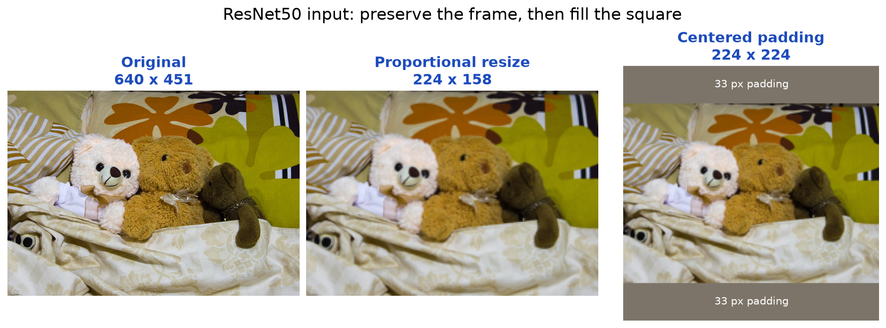
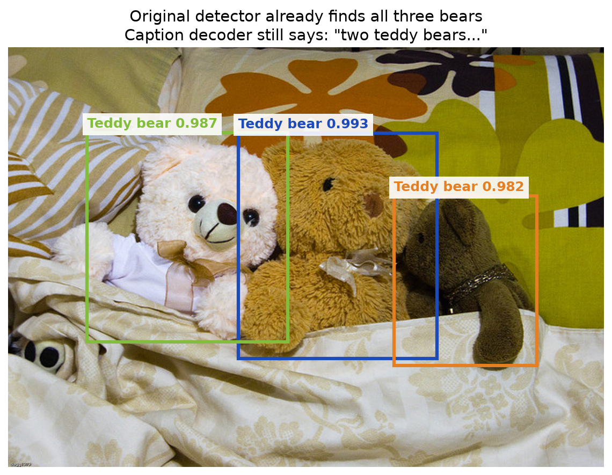

# Visual examples: what enters the model

Open [Data_Visual_Examples.ipynb](../Data_Visual_Examples.ipynb) for three short, executable CPU cells. It includes this COCO image, so it does not need the dataset, model weights or a GPU. The resizing is computed live; detector and caption outputs are recorded evidence.

## 1. ResNet50: resize, then pad

The original image is **640 x 451** pixels. `ImageOps.contain` reduces it to **224 x 158**. `ImageOps.pad` centers that image in a **224 x 224** square, adding **33 pixels above and 33 below**. We use bilinear interpolation and the recorded padding color `(124,116,104)`.

The full frame is kept: there is **no crop**. The aspect ratio is preserved up to integer pixel rounding. The padding occupies space but does not stretch the objects. The model then converts pixels to a tensor and applies ImageNet normalization. This figure displays RGB pixels before normalization.

Faster R-CNN has a separate path. It receives the original RGB photograph and uses its own aspect-preserving resize. For this image, the recorded baseline detector size was **1135 x 800** (width x height), padded internally to **1152 x 800** for the feature batch. It does not receive the ResNet branch's 224 x 224 square. The detector uses its pretrained normalization and resize settings.

## 2. Detector boxes and the counting error

These are recorded Faster R-CNN outputs, not new detections computed for this page. Three distinct teddy-bear regions survived project selection, with scores **0.993, 0.987 and 0.982**. The illustration shows those three strong boxes for readability. The complete selection contains seven regions, including a weaker overlapping teddy-bear box and other regions; see the [full before/after selection figure](../results/followup_20261126/resolution/teddy_bears/baseline_detections.png).

The final caption is still **“two teddy bears are laying on a bed .”** Therefore, this failure is not explained simply by the detector missing the third bear. Region vectors are information for the decoder, not an enforced object count. Detection labels shown on the figure are diagnostic text; category names are not supplied as words to the caption decoder.

## 3. The same photo at four input settings

These captions are copied from [comparison.json](../results/followup_20261126/resolution/teddy_bears/comparison.json). All four use the original frozen-CNN Fusion model, epoch 11, beam size 5, length penalty 0 and at most 33 generated tokens.

| Input setting | Recorded generated caption |
|---|---|
| Baseline | two teddy bears are laying on a bed . |
| Larger detector | a teddy bear laying on top of a bed . |
| Larger ResNet | two stuffed animals are laying on a bed . |
| Both larger | a teddy bear laying on top of a bed . |

None fixes this counting example. Enlarging an image does not add missing source detail. The full paired validation on 5000 images also favored the original preprocessing: CIDEr-D **0.98034** versus **0.96732**, **0.95128** and **0.93183** for these larger-input variants. See [FinalFusion_Resolution.ipynb](../FinalFusion_Resolution.ipynb) for the pilot and full-validation comparison. This single photo illustrates a limitation; it does not measure how often counting fails.

## 4. Original human captions

The following are the five unmodified human references from `captions_val2017.json` for image 113403:

- Three teddy bears laying in bed under the covers.
- A group of stuffed animals sitting next to each other in bed.
- A white, beige and brown baby bear under a beige/white comforter.
- A trio of teddy bears bundled up on a bed.
- Three stuffed animals lay in a bed cuddled together.

The captions emphasize different details. Three explicitly state a count; the others give valid broader descriptions. Training uses one sampled human caption per image per epoch; metric evaluation retains all human references.

## Source and reuse

The bundled [original JPEG](assets/data_examples/coco_val2017_000000113403.jpg) is COCO val2017 image **113403**, copied unchanged. The supplied COCO annotation metadata identifies its license as [CC BY 2.0](https://creativecommons.org/licenses/by/2.0/), and links the [original Flickr photograph](https://www.flickr.com/photo.gne?id=3713015524) ([original image URL](http://farm3.staticflickr.com/2613/3713015524_bac439d1e6_z.jpg)). The metadata supplied with COCO does not name the photographer. The source identifiers, license, SHA-256 and all five caption annotation IDs are preserved in [the example metadata](assets/data_examples/coco_val2017_000000113403.json).

The resizing illustration changes image dimensions and adds padding; detector illustrations add recorded boxes and labels. These modifications are for explaining the actual preprocessing and observed model behavior. No personal photos are included.
